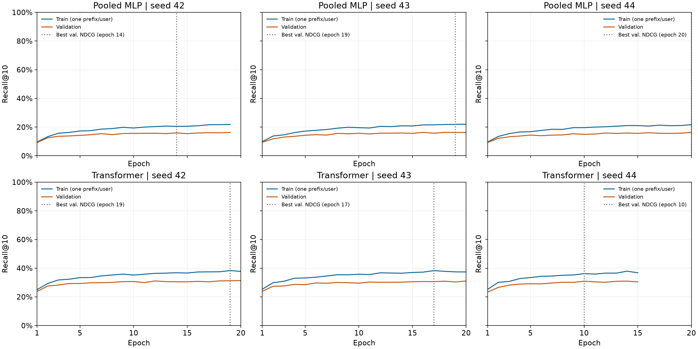

# Movie recommendation: pooled histories and causal transformers

SSY340, Chalmers. Group 100: Karl Egeland and Erik Gälldin.

Predict the next recorded positive MovieLens 1M interaction with a pooled-history MLP or a causal transformer. Both use shared history/candidate item embeddings and full-catalogue ranking. See [reported results](docs/reported_results.md) for the original measurements and limitations.

## Start here

1. **Understand the experiment:** [protocol and code map](docs/workflow.md).
2. **Generate report figures from downloaded runs:** [report reproduction](docs/report_reproduction.md).
3. **Train or evaluate:** commands in [workflow](docs/workflow.md).

## Local setup

Python 3.11 is required. With uv installed:

```bash
uv sync --group dev
uv run python -m pytest tests/ -q
```

The local dependency lock uses PyTorch 2.2.2. Original GPU training used a separate conda environment with PyTorch 2.3.1+cu118 on an NVIDIA L4. Plotting saved JSON logs does not require loading PyTorch or checkpoints; do not use the local lock to replace the established cloud environment.

## Report generation

Import only the small logs needed for plotting, validate them, and generate the two learning-curve figures:

```bash
uv run python scripts/make_report_results.py --archive /path/to/train_recall_results.tar.gz --curves-only
```

Once the original test summary, original training logs and shuffle diagnostics are in place, generate all report figures and tables:

```bash
uv run python scripts/make_report_results.py
```

Outputs go to `report/generated/`, which must be empty or absent. Use `--output-dir` for a fresh destination. Use `--validate-only` to check data without plotting. See the reproduction guide for required paths and Overleaf integration.

Training and evaluation modules remain under `src/`; report orchestration is under `scripts/`. Raw data, checkpoints and generated figures are excluded from Git. Small, non-personal aggregate result logs can be committed under `results/`.

## What training looks like

The plots below show training and validation Recall@10 for both models
across three random seeds. Training recall is measured on one fixed
training example per user. The dotted lines mark the epochs selected
using validation NDCG@10.



The small result files are included in `results/training_curves/`.
To recreate these plots and the training-loss figure, run:

```bash
uv run python scripts/make_report_results.py --curves-only
```

These curves come from extra runs used to inspect training.
The original test results are listed in `docs/reported_results.md`

## References

- Harper and Konstan (2015), The MovieLens Datasets: History and Context.
- Kang and McAuley (2018), Self-Attentive Sequential Recommendation.